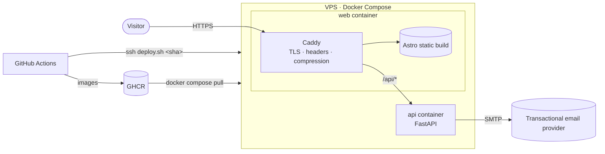

# Portfolio website

Personal portfolio of TODO(content: name), a software engineer interested in software
development, AI and DevOps.

The site is self-hosted with Docker on a VPS, and is meant to be evidence of the practices it
describes: typed code, tests and accessibility checks, hardened containers, CI/CD with
vulnerability scanning, and architecture decision records.

| | |
|---|---|
| **Frontend** | Astro 7 (static), TypeScript (strictest), Tailwind CSS 4 |
| **Backend** | Python 3.14, FastAPI, Pydantic v2 |
| **Infrastructure** | Docker Compose, Caddy (HTTPS, headers, reverse proxy) |
| **Quality** | ESLint, Prettier, Vitest, Playwright + axe, Ruff, mypy `--strict`, pytest (99% coverage) |
| **Delivery** | GitHub Actions, GHCR, Trivy, hadolint, Dependabot |
| **Lighthouse** | 99–100 in all four categories, mobile and desktop (local production build) |

## Features

- **Home**: introduction, featured projects, skills overview.
- **Projects**: one Markdown file per project, Zod-validated; list with a tag filter
  (shareable `?tag=` URL, works without JavaScript) and generated detail pages.
- **About** and **CV**: rendered from structured YAML; CV with PDF download and print stylesheet.
- **Contact**: accessible form → FastAPI → transactional SMTP provider, with honeypot,
  per-IP rate limiting and announced loading/success/error states.
- **Everywhere**: French (default, at the root) and English (`/en/...` URLs), switch in the
  header, `hreflang`; subtle motion (scroll reveal, typed home pitch, page cross-fade) that
  is skipped under `prefers-reduced-motion`; responsive layout, light/dark theme (system default, remembered choice), SEO metadata,
  sitemap, robots.txt, strict Content Security Policy, localised 404 page.

## Architecture



- Only Caddy is exposed; the API publishes no port and is reached on the same origin under
  `/api`, so there is no CORS configuration.
- The backend is organised by feature (`app/features/<name>/`), ready for the planned AI chatbot
  (`app/features/chat/`) without restructuring.
- Decisions and trade-offs are recorded in [`docs/adr/`](docs/adr/).

## Getting started

### Prerequisites

- Docker with Docker Compose v2.24+
- GNU Make and a POSIX shell (Linux, macOS, WSL, or Git Bash on Windows)
- For running tools outside Docker: Node.js 22+ and pnpm 12 (pnpm downloads the exact Node
  version pinned in `frontend/package.json`), Python tooling through [uv](https://docs.astral.sh/uv/)

### Run it

```bash
cp .env.example .env     # defaults work for local development
make install             # dependencies, Playwright browser, pre-commit hooks
make dev                 # full stack with hot reload
```

| URL | Service |
|---|---|
| <http://localhost:4321> | Site (Astro dev server, hot reload, proxies `/api`) |
| <http://localhost:8000/api/docs> | API documentation (development only) |
| <http://localhost:8025> | Mailpit: every email sent in development lands here |

Production-like stack (Caddy + built images, HTTPS with a local certificate):

```bash
make up                  # https://localhost
make down
```

> `make up` sends contact emails through the SMTP settings of `.env`. Leave the placeholder
> values to avoid sending real emails; the form then reports that sending failed.

## Commands

| Command | What it does |
|---|---|
| `make help` | List every target |
| `make install` | Install frontend and backend dependencies and the pre-commit hooks |
| `make dev` | Run the stack with hot reload and Mailpit |
| `make lint` | ESLint, Prettier, Ruff and hadolint |
| `make format` | Auto-format all code |
| `make typecheck` | `astro check` and `mypy --strict` |
| `make test` | Vitest and pytest with coverage (fails under 80%) |
| `make e2e` | Build, then Playwright smoke, contact, SEO, broken-link and axe tests |
| `make build` | Build the static site and both Docker images |
| `make scan` | Trivy vulnerability scan of the local images |
| `make up` / `make down` | Start / stop the production-like stack |

Per-app commands (`pnpm …`, `uv run …`) are listed in [`CLAUDE.md`](CLAUDE.md#commands).

## Editing the content

The site is bilingual: every piece of content exists in English (`en`) and French (`fr`).
Remaining placeholders are marked `TODO(content)`: `grep -rn "TODO(content)" frontend/src`.

| To change | Edit |
|---|---|
| Name, title, pitch, bio, interests, links, photo | `frontend/src/content/profile.yaml`, `en:` and `fr:` entries (+ image in `frontend/src/assets/`) |
| CV (experience, education, skills, languages, certifications) | `frontend/src/content/cv.yaml`, `en:` and `fr:` entries |
| Downloadable CVs | replace `frontend/public/cv-en.pdf` and `frontend/public/cv-fr.pdf` |
| Projects | add `frontend/src/content/projects/en/<slug>.md` **and** `projects/fr/<slug>.md` |
| Interface labels (buttons, headings, messages) | `frontend/src/lib/i18n/ui.ts` and `client-strings.ts` |

A project is one Markdown file per language; the file name is the URL slug, identical in both
languages (`/projects/<slug>` in French and `/en/projects/<slug>` in English). Front matter is validated at build
time, and a project missing in one language fails the build with a clear message:

```markdown
---
title: My project
summary: One or two sentences (20 to 200 characters) shown on cards and as description.
date: 2026-06-01
tags: [AI, Python]
techStack: [FastAPI, PostgreSQL]
collaboration: personal   # or team: shown on cards and project pages
cover: ../../assets/projects/my-project.png
coverAlt: Screenshot of the dashboard
repositoryUrl: https://github.com/you/my-project   # optional
demoUrl: https://demo.example.com                  # optional
featured: true      # shown on the home page (newest 3)
draft: false        # drafts only appear with `pnpm dev`
---

## Context
...
```

## Configuration

Every environment variable is documented in [`.env.example`](.env.example). Secrets never go in
the repository: `.env` is git-ignored, production values live on the VPS and in GitHub secrets.

## Deployment

Pushing to `main` runs CI; on success, images tagged with the commit SHA are pushed to GHCR and
deployed over SSH, followed by a health check. Rolling back means redeploying a previous SHA.
The full procedure, from an empty VPS to rollback, is in
[`docs/deployment.md`](docs/deployment.md).

## Project structure

```text
.
├── Makefile                  # single entry point (`make help`)
├── compose.yaml              # production-like stack (web + api), hardened
├── compose.dev.yaml          # dev overrides: hot reload, Mailpit
├── .env.example              # every environment variable, documented
├── .trivyignore.yaml         # accepted vulnerabilities, each justified and expiring
├── .github/
│   ├── workflows/            # ci.yml, deploy.yml
│   └── dependabot.yml
├── docs/
│   ├── adr/                  # architecture decision records
│   └── deployment.md         # VPS setup, deploy, rollback
├── infra/
│   ├── caddy/Caddyfile       # HTTPS, security headers, caching, /api proxy
│   └── scripts/deploy.sh     # pull, start, wait for health, history
├── frontend/                 # Astro site
│   ├── src/
│   │   ├── components/       # UI components; views/ holds page bodies shared by locales
│   │   ├── layouts/          # BaseLayout (head, theme, header, footer)
│   │   ├── pages/            # thin routes (French at the root, English in en/), sitemap, robots
│   │   ├── content/          # profile.yaml, cv.yaml, projects/{en,fr}/*.md
│   │   ├── lib/              # pure, unit-tested logic, Zod schemas, i18n/ (locales, strings)
│   │   ├── scripts/          # small client scripts (theme, filter, contact form)
│   │   └── styles/           # design tokens and global CSS
│   ├── public/               # favicon, cv-en.pdf, cv-fr.pdf
│   ├── tests/                # unit/ (Vitest), e2e/ (Playwright + axe)
│   └── Dockerfile
└── backend/                  # FastAPI API
    ├── app/
    │   ├── main.py           # application factory
    │   ├── core/             # settings, logging, errors, middleware, health
    │   ├── shared/           # email sender, rate limiter
    │   └── features/contact/ # router, schemas, service
    ├── tests/                # mirrors app/
    └── Dockerfile
```

## Documentation

- Architecture decision records:
  [tech stack](docs/adr/0001-tech-stack.md) ·
  [architecture](docs/adr/0002-architecture-static-frontend-api-reverse-proxy.md) ·
  [design direction](docs/adr/0003-design-direction.md) ·
  [backend building blocks](docs/adr/0004-backend-building-blocks.md) ·
  [containers and reverse proxy](docs/adr/0005-containers-and-reverse-proxy.md) ·
  [internationalisation](docs/adr/0006-internationalisation.md)
- [Deployment guide](docs/deployment.md)
- [Contributor and AI-assistant conventions](CLAUDE.md)

## Notes for Windows

Use Git Bash (or WSL) for `make`. File watching inside the dev containers uses polling, because
file events do not cross Docker Desktop bind mounts. After changing frontend dependencies, renew
the dev `node_modules` volume:
`docker compose -f compose.yaml -f compose.dev.yaml up --build --renew-anon-volumes`.
