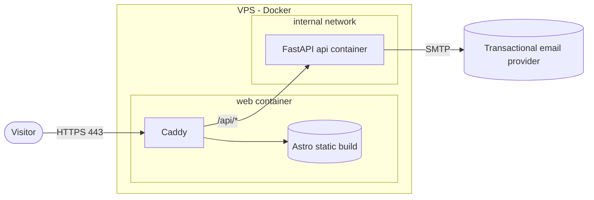

# 0002. Architecture: static frontend + API behind a reverse proxy

- **Status**: Accepted
- **Date**: 2026-11-18

## Context

Almost every page is static. The only server-side behaviour today is sending contact emails; a
chatbot will follow. The site runs on one VPS and must be secure by default, cheap to run and easy
to roll back.

## Decision

We run **two containers** behind a single origin:

- **`web`**: Caddy serves the Astro static build, terminates TLS, adds security headers, compresses
  responses and reverse-proxies `/api/*`. It is the only container that publishes ports (80/443).
- **`api`**: FastAPI, reachable only on an internal Docker network. All routes live under
  `/api/v1/...`, the health check is `GET /api/health`.
- The browser calls `/api/...` on the **same origin**, so no CORS configuration exists.
- Caddy forwards the real client IP (`X-Forwarded-For`) so the API can rate-limit per client.
- Backend code is organised **by feature** (`app/features/<name>/`), so the chatbot becomes
  `app/features/chat/` without touching existing features.

## Alternatives considered

- **Single container (FastAPI serving the static files)**: fewer moving parts, but couples the
  static site's availability to the Python process and gives up Caddy's TLS and caching features.
- **Separate API subdomain**: needs CORS, a second certificate and cookies/headers on two origins.
- **Serverless functions for the contact form**: contradicts the self-hosting goal and fragments
  the backend before the chatbot arrives.

## Consequences

- The static site keeps working even if the API is down; only the contact form degrades.
- The API is never exposed directly, which removes a whole class of attacks and of configuration.
- Streaming responses for the future chatbot (Server-Sent Events) must not be buffered by Caddy;
  this is supported by `reverse_proxy` with `flush_interval -1` when needed.
- Rate limiting is in-memory in a single API process. Scaling to several replicas would require a
  shared store (e.g. Redis), recorded as a future ADR if it ever happens.
