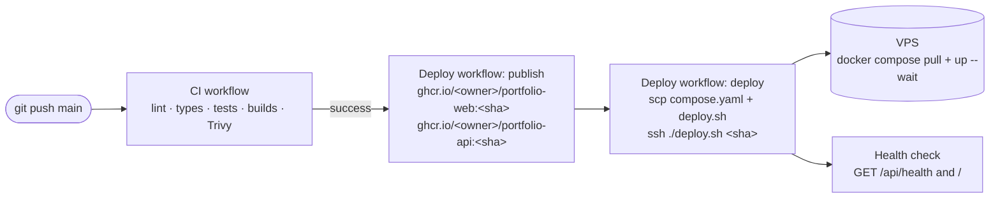

# Deployment

The site runs on a single VPS with Docker Compose. GitHub Actions builds the images, pushes them
to the GitHub Container Registry (GHCR) and deploys them over SSH.



- Images are tagged with the **full git SHA** (and `latest`). The VPS always runs an explicit SHA,
  so any previous version can be redeployed: that is the rollback mechanism.
- `infra/scripts/deploy.sh` pulls the images, starts the containers, waits for their Docker
  healthchecks, records the SHA in `.deploy-history` and keeps the 5 most recent images.

---

## 1. Prepare the VPS (once)

Commands assume a current Ubuntu LTS server and are run as `root` (or with `sudo`) unless stated.

### 1.1 System updates

```bash
apt update && apt full-upgrade -y
apt install -y unattended-upgrades
dpkg-reconfigure --priority=low unattended-upgrades   # enable automatic security updates
```

### 1.2 Non-root deploy user with SSH key authentication

On **your machine**, create a key for yourself if you do not have one:

```bash
ssh-keygen -t ed25519 -C "you@laptop"
```

On the **VPS**:

```bash
adduser --disabled-password --gecos "" deploy
install -d -m 700 -o deploy -g deploy /home/deploy/.ssh
# Paste your public key (~/.ssh/id_ed25519.pub) into:
nano /home/deploy/.ssh/authorized_keys
chown deploy:deploy /home/deploy/.ssh/authorized_keys && chmod 600 /home/deploy/.ssh/authorized_keys
```

Check that `ssh deploy@<vps-ip>` works **before** hardening SSH, then edit
`/etc/ssh/sshd_config` (or a file in `/etc/ssh/sshd_config.d/`):

```text
PermitRootLogin no
PasswordAuthentication no
KbdInteractiveAuthentication no
```

```bash
systemctl reload ssh
```

### 1.3 Firewall

```bash
ufw default deny incoming
ufw default allow outgoing
ufw allow OpenSSH
ufw allow 80/tcp
ufw allow 443/tcp
ufw allow 443/udp      # HTTP/3
ufw enable
```

> Docker publishes ports through its own iptables rules, which bypass `ufw`. This is safe here
> because only the `web` container publishes ports (80/443), which must be public anyway; the API
> publishes none. Never add `ports:` to the `api` service in production.

### 1.4 Docker Engine

Install Docker Engine and the Compose plugin from Docker's official repository, following
<https://docs.docker.com/engine/install/ubuntu/>. Then:

```bash
usermod -aG docker deploy      # lets the deploy user run docker without sudo
docker compose version         # Compose v2.24+ is required
```

> Membership of the `docker` group is equivalent to root on the host. It is the usual trade-off
> for a single-purpose VPS; protect the deploy SSH key accordingly.

### 1.5 Deployment directory and production `.env`

As the `deploy` user:

```bash
sudo install -d -o deploy -g deploy -m 750 /opt/portfolio
cd /opt/portfolio
nano .env          # start from .env.example in the repository
chmod 600 .env
```

Production values (see `.env.example` for every variable):

| Variable | Production value |
|---|---|
| `DOMAIN` | your domain, e.g. `example.com` |
| `SITE_URL` | `https://example.com` (informational on the VPS: it is baked into the image at build time) |
| `APP_ENV` | `production` |
| `SMTP_*` | credentials of the transactional email provider (Brevo, Resend, Mailgun...) |
| `CONTACT_FROM_EMAIL` | a sender address verified by the provider, on your domain |
| `CONTACT_TO_EMAIL` | the inbox that receives contact messages |
| `WEB_IMAGE` | `ghcr.io/<owner>/portfolio-web` (**lowercase** owner) |
| `API_IMAGE` | `ghcr.io/<owner>/portfolio-api` (**lowercase** owner) |
| `IMAGE_TAG` | leave any value; the deploy script overrides it |

### 1.6 Registry access

GHCR packages are private by default. Either make both packages public (GitHub → your profile →
Packages → package settings → Change visibility), or log the VPS in with a token that can only
read packages:

```bash
# As deploy. Token: GitHub → Settings → Developer settings → Personal access tokens,
# classic token with only the `read:packages` scope.
echo "<token>" | docker login ghcr.io -u <github-username> --password-stdin
```

### 1.7 DNS

Create the records at your DNS provider and wait for them to propagate:

| Type | Name | Value |
|---|---|---|
| `A` | `@` | IPv4 of the VPS |
| `AAAA` | `@` | IPv6 of the VPS (if it has one) |

Caddy obtains and renews Let's Encrypt certificates automatically on first start, as soon as the
domain resolves to the VPS and ports 80/443 are reachable. Certificates live in the
`caddy_data` volume.

---

## 2. Configure GitHub (once)

### 2.1 Dedicated deploy key

On your machine, create a key pair used **only** by GitHub Actions:

```bash
ssh-keygen -t ed25519 -N "" -C "github-actions-deploy" -f deploy_key
```

Append `deploy_key.pub` to `/home/deploy/.ssh/authorized_keys` on the VPS. Then record the VPS
host key, from a machine you trust, and compare its fingerprint with the one shown by your
hosting provider's console (`ssh-keygen -lf /etc/ssh/ssh_host_ed25519_key.pub` on the VPS):

```bash
ssh-keyscan -t ed25519 <vps-ip-or-domain> > known_hosts_entry
ssh-keygen -lf known_hosts_entry
```

### 2.2 Secrets and variables

Repository → Settings → Environments → create **`production`** (optionally add yourself as a
required reviewer to approve every deployment). Add these **environment secrets**:

| Secret | Value |
|---|---|
| `DEPLOY_HOST` | VPS IP or hostname |
| `DEPLOY_USER` | `deploy` |
| `DEPLOY_SSH_KEY` | content of the private key `deploy_key` |
| `DEPLOY_KNOWN_HOSTS` | content of `known_hosts_entry` |

Then Settings → Secrets and variables → Actions → **Variables** (repository level, read by both
the publish and the deploy jobs):

| Variable | Value |
|---|---|
| `SITE_URL` | `https://example.com` (baked into the image at build time, used by the health check) |
| `DEPLOY_PATH` | optional, defaults to `/opt/portfolio` |

Delete the local `deploy_key` files once stored in GitHub.

`GITHUB_TOKEN` is enough to push to GHCR; no extra secret is needed.

---

## 3. Deploy

**Automatic**: every push to `main` runs CI; when it succeeds, the **Deploy** workflow builds and
pushes the images tagged with the commit SHA, then deploys them and checks
`https://<domain>/api/health` and the home page.

**Manual**: Actions → **Deploy** → *Run workflow* → `image_tag` = the full SHA to deploy (the
images for that SHA must already exist in GHCR).

Verify:

```bash
curl -fsS https://example.com/api/health                 # {"status":"ok"}
ssh deploy@<vps> 'cd /opt/portfolio && docker compose ps && tail -n 5 .deploy-history'
```

---

## 4. Roll back

Every deployed SHA is still in GHCR, and the 5 most recent are cached on the VPS.

1. Find the last good SHA: `ssh deploy@<vps> 'tail /opt/portfolio/.deploy-history'`, or the
   history of the **Deploy** workflow in GitHub Actions.
2. Redeploy it, either:
   - **from GitHub** (preferred, also restores the matching `compose.yaml`): Actions → **Deploy**
     → *Run workflow* → `image_tag` = that SHA; or
   - **from the VPS** (if GitHub is unavailable):

     ```bash
     ssh deploy@<vps>
     cd /opt/portfolio && ./deploy.sh <good-sha>
     ```

3. Fix forward with a new commit on `main`; the next successful CI run deploys it.

> A rollback restores code and configuration, not data. The application is stateless (the only
> persistent data is Caddy's certificates), so no data migration is ever involved.

---

## 5. Operations

| Task | Command (in `/opt/portfolio` as `deploy`) |
|---|---|
| Status and health | `docker compose ps` |
| Logs (JSON lines for the API) | `docker compose logs -f --tail=100 api` |
| Restart after editing `.env` | `docker compose up -d --force-recreate` |
| Disk usage | `docker system df` |
| Deployment history | `cat .deploy-history` |

- **Backups**: keep a copy of `.env` in a password manager. Certificates are re-issued
  automatically if the `caddy_data` volume is lost (mind Let's Encrypt rate limits).
- **Secrets rotation**: update `.env` on the VPS (SMTP) or the GitHub secrets (SSH key), then
  restart the stack or re-run the workflow.
- **Troubleshooting**: if certificates are not issued, check that DNS points to the VPS and that
  ports 80/443 are open (`docker compose logs web`).
